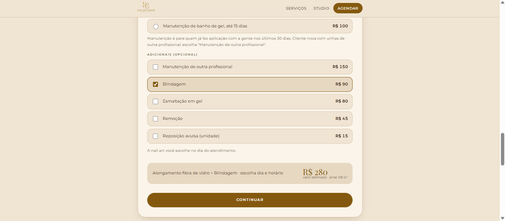
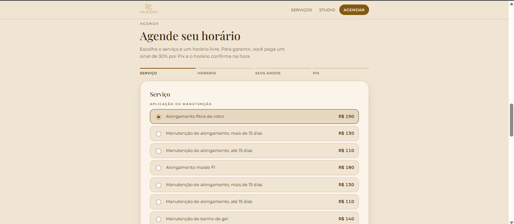

# Sistema de Agendamento

Sistema web desenvolvido para facilitar o agendamento online de serviços de manicure, permitindo que as clientes escolham serviços e horários disponíveis, realizem o pagamento do sinal por Pix e acompanhem seus agendamentos. A plataforma também oferece um painel administrativo para gerenciamento da agenda e das informações do site.


---

## Sobre o projeto

O Sistema de Agendamento foi desenvolvido em equipe como projeto acadêmico, com foco na organização e digitalização do processo de agendamento de serviços de manicure.

A plataforma permite que as clientes consultem os serviços disponíveis, escolham uma data e um horário, preencham seus dados e realizem o pagamento do sinal por Pix. Após a confirmação do pagamento, o agendamento é confirmado automaticamente.

A profissional conta com um painel administrativo para visualizar e gerenciar a agenda, configurar horários, atualizar serviços e valores e editar os textos e as imagens do site.

O sistema foi desenvolvido para atender à manicure Kailane Bonfim, mas sua estrutura foi planejada para possibilitar a adaptação a outras profissionais da área.

## Status do projeto

- **Status:** projeto acadêmico concluído.
- **Plataforma:** sistema web responsivo.
- **Pagamento:** integração com Mercado Pago para pagamento de sinal por Pix.

---

## Funcionalidades

### Agendamento online

- Consulta aos serviços disponíveis;
- Seleção de um ou mais serviços;
- Escolha de dias e horários disponíveis;
- Preenchimento dos dados da cliente;
- Reserva temporária do horário durante o processo de pagamento;
- Confirmação automática do agendamento após a identificação do pagamento;
- Acompanhamento do agendamento por meio de um link pessoal;
- Remarcação e cancelamento de agendamentos.

### Pagamento

- Pagamento do sinal por Pix;
- Geração de QR Code para pagamento;
- Verificação do status do pagamento;
- Confirmação do agendamento após a aprovação do pagamento;
- Tratamento de devoluções conforme as regras de negócio definidas para o sistema.

### Painel Administrativo

- Acesso da profissional por e-mail e senha;
- Visualização e gerenciamento da agenda;
- Abertura de horários extras;
- Bloqueio de dias e horários;
- Gerenciamento de serviços e valores;
- Consulta às informações das clientes;
- Edição dos textos e das imagens do site.

### Interface e experiência do usuário

- Layout responsivo para celulares e computadores;
- Navegação simples e organizada;
- Etapas de agendamento com orientações claras;
- Interface planejada para facilitar a conclusão do agendamento.

---

## Tecnologias utilizadas

### Front-end

- HTML5
- CSS3
- JavaScript

### Back-end e funções de servidor

- TypeScript
- Funções de servidor para integração com o Mercado Pago
- Webhooks para notificação e verificação dos pagamentos

### Banco de Dados e Autenticação

- Supabase
- PostgreSQL
- Serviço de autenticação do Supabase

### Integração de Pagamentos

- Mercado Pago
- Pix
- Checkout API de Pagamentos

### Publicação

- Cloudflare Pages

---

## 📁 Estrutura do projeto

As imagens das telas estão organizadas na pasta `Imagens`.

```text
SistemaDeAgendamento
├── Imagens
│   ├── Adicionais.png
│   ├── Agenda.png
│   ├── Serviços 1.png
│   ├── Serviços 2.png
│   ├── Sobre mim.png
│   └── Tela Inicial.png
└── README.md
```

*Estrutura ilustrativa das imagens e do README. Os demais diretórios e arquivos podem ser acrescentados conforme a organização real do repositório.*

---

## Telas do Sistema

A seguir, são apresentadas as principais telas do Sistema de Agendamento.

<table>
<tr>
<td align="center" width="50%">
<strong>Tela Inicial</strong><br><br>

</td>
<td align="center" width="50%">
<strong>Sobre Mim</strong><br><br>

</td>
</tr>
<tr>
<td align="center" width="50%">
<strong>Serviços — Etapa 1</strong><br><br>

</td>
<td align="center" width="50%">
<strong>Serviços — Etapa 2</strong><br><br>

</td>
</tr>
<tr>
<td align="center" width="50%">
<strong>Adicionais</strong><br><br>

</td>
<td align="center" width="50%">
<strong>Agenda</strong><br><br>

</td>
</tr>
</table>

---

## Como funciona o agendamento

1. A cliente acessa o site e consulta os serviços disponíveis.
2. Escolhe os serviços desejados e um horário disponível.
3. Preenche seus dados para realizar o agendamento.
4. Efetua o pagamento do sinal por Pix.
5. O sistema verifica a aprovação do pagamento e confirma o agendamento.
6. Após a confirmação, a cliente recebe um link pessoal para acompanhar, remarcar ou cancelar o horário, conforme as regras do sistema.

---

## Equipe

Projeto desenvolvido em equipe como parte das atividades acadêmicas.

**Integrantes:**
- Jessica Dantas
- Yasmim Tomas

Este repositório foi publicado por **Jessica Dantas** como parte do projeto acadêmico.

---

**Sistema de Agendamento — Mais praticidade, organização e segurança na marcação de serviços.**
